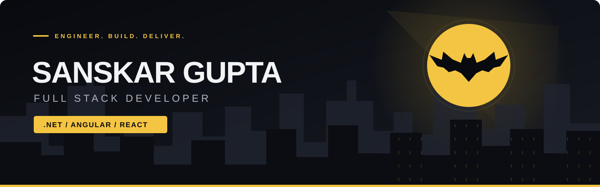
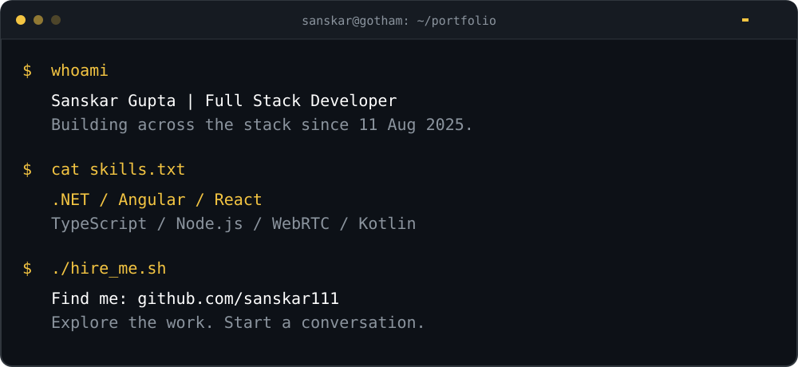

  <strong>I build across the stack — from the interface to the API.</strong> 
  Full Stack Developer · .NET · Angular · React

  
  

  <a href="#-selected-work">Selected work</a> ·
  <a href="#-experience">Experience</a> ·
  <a href="#-utility-belt">Tech stack</a>

---

## 🦇 The developer behind the signal

I'm **Sanskar Gupta**, a **Full Stack Developer** working with **.NET, Angular, and React**. I build web interfaces and backend services, with projects in real-time communication and native Android development.

- 🛠️ **Professional stack:** .NET, Angular, React
- 🎙️ **Featured build:** [TalkSick](https://github.com/sanskar111/voice-chat-app) — voice and text chat with WebRTC
- 📱 **Also built:** Kotlin apps for arithmetic practice and everyday tasks

## 🚀 Selected work

| Project | What it does | Stack | Explore |
| :--- | :--- | :--- | :--- |
| **🎙️ TalkSick** | Topic-based rooms for real-time voice and text chat. **Highlights:** WebRTC audio, Google sign-in, and an active-room lobby. |    | [Repository](https://github.com/sanskar111/voice-chat-app) · [Demo](https://talksick.web.app) |
| **🧮 MathGenius** | An Android arithmetic game with randomized questions. **Highlights:** 3 operation modes, 10-second rounds, scoring, and lives. |   | [Repository](https://github.com/sanskar111/MathGenius) |
| **✅ TOdo** | A lightweight Android app for managing a task list. **Highlights:** Add tasks, confirm deletions, and retain the list between launches. |   | [Repository](https://github.com/sanskar111/TOdo) |

## 💼 Experience

**Full Stack Developer** · *11 August 2025 — Present*  
Working with **.NET, Angular, and React**.

## 🛠️ Utility belt

**Backend**  

**Frontend**  

**Languages & mobile**  

**Data & real-time**  

**Cloud & delivery**  

<strong>📡 Activity radar</strong>

 

  
  

  

---

  <strong>Let the work send the signal.</strong> 
  Built to be explored — <a href="https://github.com/sanskar111?tab=repositories">take a look around.</a>

